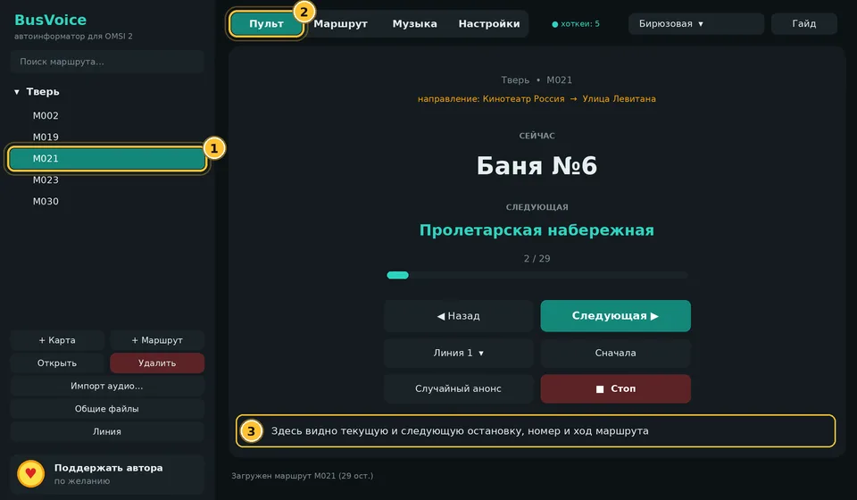
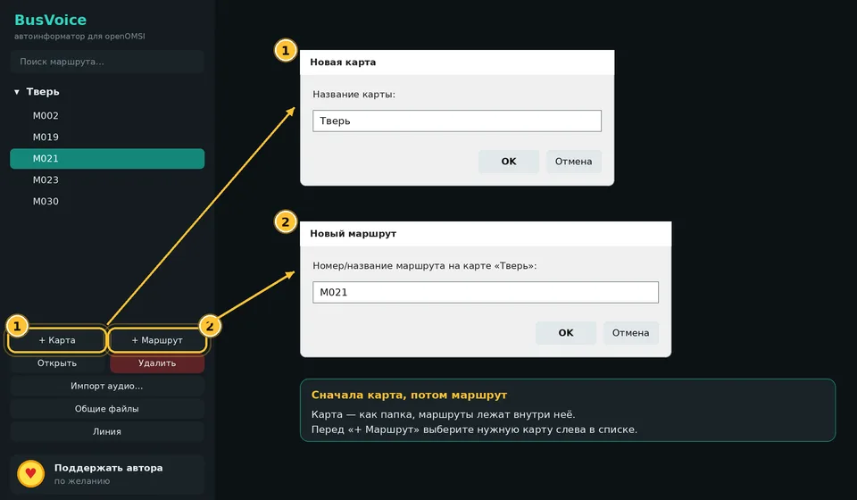
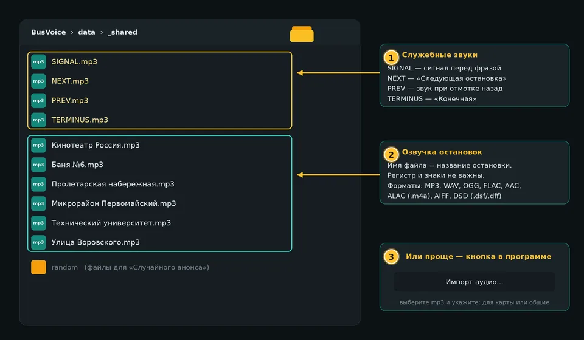
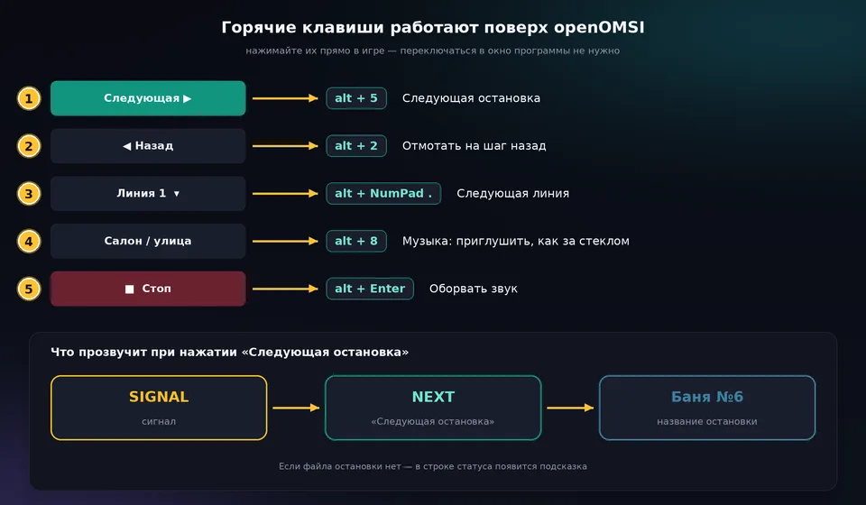
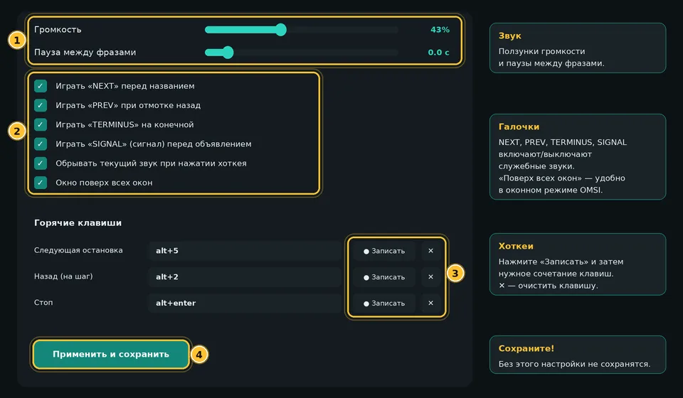
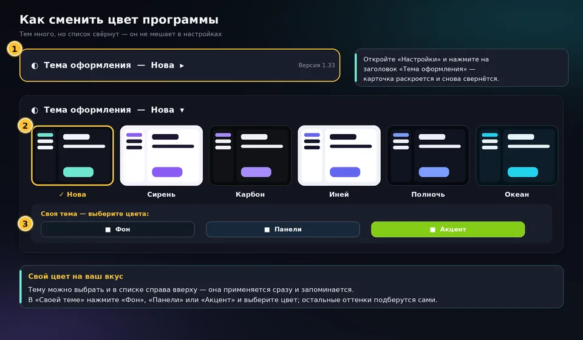

# 🚌 BusVoice

**Современный автоинформатор остановок для openOMSI**
голос · музыка · радио · авто-режим · 5 языков

[YouTube](https://www.youtube.com/@THEIGOREK) · [ВКонтакте](https://vk.ru/the_igorek) · [Telegram](https://t.me/the_ig0rek) · [❤ Поддержать автора](https://dalink.to/theigorek)

---

## ✨ Что это

**BusVoice** объявляет остановки в автобусе так, как это делает настоящий информатор: сигнал → «Следующая остановка» → название. Программа работает поверх игры, понимает готовые озвучки (MP3 и десятки других форматов) и умеет сама озвучивать названия голосом, если файла нет. Для **openOMSI** есть авто-режим: остановки объявляются сами, без нажатия клавиш.

## Счётчик «онлайн»

Справа вверху показывается, сколько человек пользуется BusVoice прямо сейчас. Для этого программа раз в ~25 секунд отправляет в публичный MQTT-брокер случайный анонимный код (без имени, IP-адреса и путей) и номер версии. Данные нигде не сохраняются.

## Игра по сети

В openOMSI LAN игроки с BusVoice слышат друг друга: объявления остановок и музыку (ссылка/радио) соседнего автобуса. Плагин BusVoiceNet ставится автоматически, настройки в игре — `Ctrl+Alt+B`. Звук объёмный (3D): внутри чужого автобуса музыку и объявления слышно нормально, снаружи — тихо и только рядом с автобусом.

## Реальная погода

В настройках BusVoice: галочка «Реальная погода», режим «Авто» (ближайший к карте аэропорт) или выбор города вручную из списка аэропортов мира (ICAO, ~10 000 кодов). Список можно обновить из интернета; если вашего города нет — впишите код ICAO. BusVoice записывает `metar_sync` и `metar_station` в настройки openOMSI (`~/.openomsi/launcher.json`), погода применяется при следующем запуске игры.

## 🎯 Возможности

| | |
|---|---|
| 🔔 **Объявления остановок** | Сигнал, «Следующая остановка», название, «Конечная». Всё включается и выключается галочками. |
| 🗣️ **Голосовая озвучка** | Нет MP3? Названия озвучат нейроголоса Microsoft: **BEL · UK · KAZ · ENG · RUS**, мужские и женские. Выбранный голос используется всегда, готовые фразы сохраняются и работают без интернета. |
| 🚏 **Карты, маршруты, линии** | Любое число карт и маршрутов, у маршрута — несколько линий (туда, обратно и т. д.). Список остановок можно вставить из Блокнота или импортировать из **HOF-файла**, в том числе с переводом на RU / UK / KAZ / BEL. |
| 🤖 **Авто-режим для openOMSI** | Плагин встроен и ставится сам. Программа видит рейс, расстояние и скорость и объявляет остановки без клавиш. Звук — из салона и снаружи автобуса. |
| 🎵 **Музыка и радио** | Свои файлы, радио, ссылки (YouTube и другие сайты), VK, Яндекс Музыка. Во время объявления музыка становится тише. |
| 🪟 **Мини-панель поверх игры** | Бегущая строка, два ползунка громкости (информатор и музыка), прозрачность и масштаб. |
| ⌨️ **Горячие клавиши** | Работают поверх openOMSI, настраиваются в программе. |
| 🎨 **Темы** | Светлая, тёмная (графит), «Закат», бирюзовая и **своя тема** — три цвета на выбор. |
| 🌍 **5 языков интерфейса** | Русский, English, Українська, Беларуская, Қазақша — с флагами. |
| 🔄 **Автообновление** | Программа сама проверяет новую версию и показывает окно «Что нового». Заходить на GitHub не нужно. |
| 🎧 **Много форматов звука** | WAV, AIFF, FLAC, ALAC, APE, WavPack, TAK, MP3, AAC, OGG, Opus, WMA, DSD, DTS, AC3 и другие. |

## 📥 Установка

Никакого установщика — скачиваете архив, распаковываете и сразу играете. Внутри уже всё нужное, включая свой Python.

1. Скачайте **[BusVoice_Portable.zip](https://github.com/THEIGOREK/BusVoice/releases/latest/download/BusVoice_Portable.zip)**.
2. Создайте папку в любом месте (например, на рабочем столе) и перетащите туда всё содержимое архива.
3. Откройте в этой папке файл **BusVoice.exe** — программа запустится сразу.

**Как удалить:** удалите всё содержимое папки, после этого удалите саму папку. Больше ничего в системе не остаётся.

## 🛡 Проверка на вирусы

Каждая версия BusVoice — и файл обновления, и установщик — автоматически отправляется на **[VirusTotal](https://www.virustotal.com)** (70+ антивирусных движков) прямо из GitHub Actions ([код](.github/scripts/vt_scan.py)), без участия автора. Нажмите на версию, чтобы открыть отчёт VirusTotal и сверить хеш SHA-256 со своим файлом.

<!-- VT:START -->
| Версия | Файл | Результат | Проверено | SHA-256 |
|---|---|---|---|---|
| [**1.37.0**](https://www.virustotal.com/gui/file/cba01bf6b5603f81e7428f59b2bc6ea6106ff298324bb75d53fddf873c94a633) | `update.zip` | ✅ чисто (0/66) | 2026-11-09 06:00 UTC | `cba01bf6b5603f81…` |
| [**1.36.1**](https://www.virustotal.com/gui/file/c1310c395ef68d06b6a56a48a69554bc29d14c630f39f7ba02d3adf4b82e0c4f) | `update.zip` | ✅ чисто (0/65) | 2026-11-08 19:24 UTC | `c1310c395ef68d06…` |
| [**1.36.0**](https://www.virustotal.com/gui/file/b9f1eaafd0c633713ce65995d845e15895bfbd0d767ce4967680a913feb09ddd) | `update.zip` | ✅ чисто (0/66) | 2026-11-08 14:42 UTC | `b9f1eaafd0c63371…` |
| [**1.35.0**](https://www.virustotal.com/gui/file/aa15a99235593e9d6eea3de284735ae517da4e399452b3e56f1975f7191c7b5d) | `update.zip` | ✅ чисто (0/66) | 2026-11-08 14:30 UTC | `aa15a99235593e9d…` |
| [**1.34.1**](https://www.virustotal.com/gui/file/b0cb90fe05477f218ef088f11281ba31ee9c4b7c973f15f67767f8fa8ef3d318) | `update.zip` | ✅ чисто (0/64) | 2026-11-08 09:23 UTC | `b0cb90fe05477f21…` |
| [**1.34.0**](https://www.virustotal.com/gui/file/e0a916c5eaf1d5a58e1cfa7c390a6502de212bf0c3209503583d838d82906625) | `update.zip` | ✅ чисто (0/63) | 2026-11-08 09:17 UTC | `e0a916c5eaf1d5a5…` |
| [**1.33.12**](https://www.virustotal.com/gui/file/874a87f6a97ef3d816abce81708aeda3381747a32840a330653eabd066666803) | `update.zip` | ✅ чисто (0/66) | 2026-11-08 05:47 UTC | `874a87f6a97ef3d8…` |
| [**1.33.11**](https://www.virustotal.com/gui/file/bf90990c73d869a485b2a139715747ec0f8af38110b72796734f349d329f59e1) | `update.zip` | ✅ чисто (0/66) | 2026-11-08 04:17 UTC | `bf90990c73d869a4…` |
| [**1.33.10**](https://www.virustotal.com/gui/file/0200f1f042f7ed95017b122ba887c0de22b27b6bee8a371602899c866af38b87) | `update.zip` | ✅ чисто (0/65) | 2026-11-07 12:22 UTC | `0200f1f042f7ed95…` |
| [**1.33.9**](https://www.virustotal.com/gui/file/7cea4ff7bc345db6f11d7a0e456dac86eb966a3664d2ca280e9a4bc6ab724116) | `update.zip` | ✅ чисто (0/65) | 2026-11-07 05:03 UTC | `7cea4ff7bc345db6…` |
| [**1.33.8**](https://www.virustotal.com/gui/file/26162ec46d79e3b3a6cfb276311fbcda576275e1c8bc427485ba4c8f025de7e6) | `update.zip` | ✅ чисто (0/64) | 2026-11-07 04:44 UTC | `26162ec46d79e3b3…` |
| [**1.33.7**](https://www.virustotal.com/gui/file/ec12ff1b1e6becdab65cef1b0a698166b5959581fd6b4ed1c5cd70abeee29c84) | `update.zip` | ✅ чисто (0/66) | 2026-11-07 04:38 UTC | `ec12ff1b1e6becda…` |
| [**1.33.6**](https://www.virustotal.com/gui/file/2ed527fd72d99b5e433f0785c28c982094b229403af8e0009b8e122ee7347abf) | `update.zip` | ✅ чисто (0/66) | 2026-11-07 04:30 UTC | `2ed527fd72d99b5e…` |
| [**1.33.5**](https://www.virustotal.com/gui/file/8503a10d674a267c25172f052586d4bd3749c39b11648bdc921a0ced85443026) | `update.zip` | ✅ чисто (0/66) | 2026-11-07 04:26 UTC | `8503a10d674a267c…` |
| [**1.33.4**](https://www.virustotal.com/gui/file/18d56e7534940babe4dc3280c0329233fce12d1dfe6cca9a0afb836ca33ff5bc) | `update.zip` | ✅ чисто (0/66) | 2026-11-07 04:19 UTC | `18d56e7534940bab…` |
| [**1.33.3**](https://www.virustotal.com/gui/file/c8e289a77b37422833c10f02b6c2f293114f475d071d93c7336421e7ad6dd136) | `update.zip` | ✅ чисто (0/66) | 2026-11-07 03:52 UTC | `c8e289a77b374228…` |
| [**1.33.2**](https://www.virustotal.com/gui/file/3cb4c41560d18befdd594d4a35752ca6d1783350e369b87b353e21f69570b351) | `update.zip` | ✅ чисто (0/65) | 2026-11-07 03:46 UTC | `3cb4c41560d18bef…` |
| [**1.33.1**](https://www.virustotal.com/gui/file/ca89974e9c8ba8780479f37bc196d23ffbb5542ae855d244405764ece090fe99) | `update.zip` | ✅ чисто (0/60) | 2026-11-06 19:41 UTC | `ca89974e9c8ba878…` |
| [**1.33.0**](https://www.virustotal.com/gui/file/4290508bd52eaeed1cacec906d9de842988eaf03c55f3d16613900f4dd7896c3) | `update.zip` | ✅ чисто (0/65) | 2026-11-06 19:33 UTC | `4290508bd52eaeed…` |
| [**1.32.0**](https://www.virustotal.com/gui/file/ff1a62e786d94ad0b0ffbdf57e383759733f32e16f33246890f619bba66685cf) | `update.zip` | ✅ чисто (0/66) | 2026-11-06 14:35 UTC | `ff1a62e786d94ad0…` |
| [**1.31.4**](https://www.virustotal.com/gui/file/8d5db4277cb57b027eaead894ae835c85ddb4fc8ccb17b77e2d1e007c61de2de) | `update.zip` | ✅ чисто (0/64) | 2026-11-06 09:34 UTC | `8d5db4277cb57b02…` |
| [**1.31.3**](https://www.virustotal.com/gui/file/702ceae6e2c07e7405bae1891b005481edf185f3a538cc57acbad148076522ce) | `update.zip` | ✅ чисто (0/64) | 2026-11-06 09:26 UTC | `702ceae6e2c07e74…` |
| [**1.31.2**](https://www.virustotal.com/gui/file/317233e3568c266de73edf01fb066bc0b9310209ef00b68a989b62dfa0173049) | `update.zip` | ✅ чисто (0/64) | 2026-11-06 09:18 UTC | `317233e3568c266d…` |
| [**1.31.1**](https://www.virustotal.com/gui/file/3493dc8f89ffb4e336c5c15923039f28930bfa1c50a2cf7ba396c5b315de873a) | `update.zip` | ✅ чисто (0/65) | 2026-11-06 09:15 UTC | `3493dc8f89ffb4e3…` |
| [**1.31.0**](https://www.virustotal.com/gui/file/e8622860ab9e44774148d63644bab7e88415240f764b9cbcfbd243c88a125094) | `update.zip` | ✅ чисто (0/65) | 2026-11-06 04:54 UTC | `e8622860ab9e4477…` |
| [**1.30.2**](https://www.virustotal.com/gui/file/a7b6f009cb6ada51aef7ad257467a08e926fbf9de2c9e09d550537d8d5b98d17) | `update.zip` | ✅ чисто (0/65) | 2026-11-06 04:44 UTC | `a7b6f009cb6ada51…` |
| [**1.30.1**](https://www.virustotal.com/gui/file/480653c32c8bc499726fbf88b68f8ee1dc2fbd3fcec251daaab0d10e8ece7e31) | `update.zip` | ✅ чисто (0/61) | 2026-11-06 04:38 UTC | `480653c32c8bc499…` |
| [**1.30.0**](https://www.virustotal.com/gui/file/12138d35082b0a6872b5226bdae03ecff1ba6c88afd8ccceb56f18e829a42fb9) | `update.zip` | ✅ чисто (0/56) | 2026-11-06 04:22 UTC | `12138d35082b0a68…` |
| [**1.29.1**](https://www.virustotal.com/gui/file/0f66f893ad20460269c9d9ccf6325f97b889a74fa6086bdbe937ddf73847efda) | `update.zip` | ✅ чисто (0/65) | 2026-11-05 09:45 UTC | `0f66f893ad204602…` |
<!-- VT:END -->

**Как проверить самому:** скачайте `BusVoice_Portable.zip` и посчитайте хеш (`certutil -hashfile BusVoice_Portable.zip SHA256` или PowerShell `Get-FileHash`), затем откройте ссылку нужной версии — хеш на странице VirusTotal должен совпасть. Подробнее: [docs/VIRUSTOTAL.md](docs/VIRUSTOTAL.md).

> Единичные срабатывания малоизвестных антивирусов на упакованные программы (в том числе на Python-приложения) бывают ложными.

## 🚀 Быстрый старт

<table>
<tr>
<td width="50%"> <b>1.</b> Создайте карту и маршрут</td>
<td width="50%"> <b>2.</b> Положите озвучки в папку или используйте голос</td>
</tr>
<tr>
<td> <b>3.</b> Жмите горячие клавиши прямо в игре</td>
<td> <b>4.</b> Настройте звук и клавиши под себя</td>
</tr>
</table>

В программе есть **анимированный гайд для новичков** на всех пяти языках — он открывается при первом запуске.

## ⌨️ Горячие клавиши по умолчанию

| Действие | Клавиши |
|---|---|
| Следующая остановка | `Alt` + `5` |
| Назад на шаг | `Alt` + `2` |
| Следующая линия | `Alt` + `NumPad .` |
| Случайная фраза | `Alt` + `0` |
| Стоп (оборвать звук) | `Alt` + `Enter` |
| Музыка: следующий / предыдущий трек | `Alt` + `6` / `Alt` + `4` |
| Музыка: громче / тише | `Alt` + `9` / `Alt` + `3` |
| Музыка: пауза | `Alt` + `7` |

Любую клавишу можно поменять в «Настройках». Если клавиши не срабатывают в игре — запустите ярлык от имени администратора.

## 🎨 Темы

## ❓ Частые вопросы

<b>Антивирус ругается на BusVoice.exe внутри архива</b>

Это **ложное срабатывание**: `BusVoice.exe` не подписан платным сертификатом, а такие непромышленные программы часто блокируют браузеры и некоторые антивирусы — особенно те, что запускают другие программы (а BusVoice.exe запускает свой Python). Нажмите «Подробнее» → «Выполнить в любом случае». Отчёты проверки лежат в разделе «🛡 Проверка на вирусы» выше, файл можно проверить и самостоятельно на [VirusTotal](https://www.virustotal.com/).

**Если Chrome / Edge блокирует скачивание архива:** откройте список загрузок (Ctrl+J) → нажмите **«⋮» / «…» у файла → «Сохранить»** (в Edge — «Сохранить» → «Всё равно сохранить»).

**Если антивирус удаляет файл:** добавьте папку с BusVoice в исключения антивируса (в Защитнике Windows: «Защита от вирусов и угроз» → «Управление настройками» → «Исключения» → «Добавить исключение» → «Папка»).

<b>Остановки звучат без MP3 — как это работает?</b>

Если для остановки нет файла, её озвучивает нейроголос Microsoft, выбранный в «Настройках → Голос озвучки». При первой озвучке фразы нужен интернет, потом она хранится на диске. Файл остановки (имя файла = название остановки) всегда в приоритете.

<b>Как работает авто-режим?</b>

Плагин для openOMSI устанавливается вместе с программой. Выберите рейс с расписанием в игре — BusVoice сам определит прибытие и отъезд. Горячие клавиши работают и без плагина.

<b>Как обновляется программа?</b>

При запуске BusVoice сам проверяет обновления, скачивает их, сверяет контрольную сумму и показывает, что изменилось. Кнопка **«⟳ Обновить»** проверяет версию вручную.

<b>Голоса пассажиров в игре</b>

Голоса пассажиров воспроизводит сама игра, API плагина их не затрагивает, поэтому BusVoice их не переводит.

## 💻 Требования

- Windows 10 / 11, 64-разрядная
- openOMSI
- Интернет при установке (скачиваются библиотеки), для голосов, радио и обновлений

## 🐞 Нашли ошибку или есть идея?

Создайте [обращение в Issues](https://github.com/THEIGOREK/BusVoice/issues/new/choose) — опишите, что случилось, и приложите скриншот.

## 👤 Автор

**THEIGOREK** — делаю инструменты для любителей автобусных симуляторов.

---

<b>🇬🇧 English</b>

**BusVoice** is a modern stop announcer for **openOMSI**: signal → "Next stop" → stop name, with neural voices (BEL · UK · KAZ · ENG · RUS) when no audio file exists, music & radio, an in-game mini panel, hotkeys, themes, 5 interface languages and an **automatic mode for openOMSI** (no key presses needed).

**Install:** download [BusVoice_Portable.zip](https://github.com/THEIGOREK/BusVoice/releases/latest/download/BusVoice_Portable.zip), extract it into any folder, and open **BusVoice.exe** inside that folder. No installer, nothing else to download — its own Python is already bundled. To remove it, delete the folder.

Source code is not published; this repository hosts the portable build and the update packages.

© THEIGOREK · BusVoice

