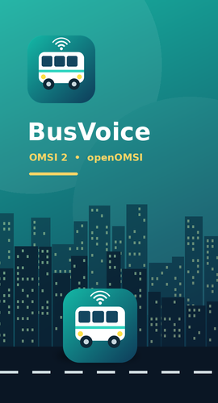

# 🚌 BusVoice

**Современный автоинформатор остановок для OMSI 2 и openOMSI**
голос · музыка · радио · авто-режим · 5 языков

[YouTube](https://www.youtube.com/@THEIGOREK) · [ВКонтакте](https://vk.ru/the_igorek) · [Telegram](https://t.me/the_ig0rek) · [❤ Поддержать автора](https://dalink.to/theigorek)

---

## ✨ Что это

**BusVoice** объявляет остановки в автобусе так, как это делает настоящий информатор: сигнал → «Следующая остановка» → название. Программа работает поверх игры, понимает готовые озвучки (MP3 и десятки других форматов) и умеет сама озвучивать названия голосом, если файла нет. Для **openOMSI** есть авто-режим: остановки объявляются сами, без нажатия клавиш.

## 🎯 Возможности

| | |
|---|---|
| 🔔 **Объявления остановок** | Сигнал, «Следующая остановка», название, «Конечная». Всё включается и выключается галочками. |
| 🗣️ **Голосовая озвучка** | Нет MP3? Названия озвучат нейроголоса Microsoft: **BEL · UK · KAZ · ENG · RUS**, мужские и женские. Выбранный голос используется всегда, готовые фразы сохраняются и работают без интернета. |
| 🚏 **Карты, маршруты, линии** | Любое число карт и маршрутов, у маршрута — несколько линий (туда, обратно и т. д.). Список остановок можно вставить из Блокнота или импортировать из **HOF-файла**, в том числе с переводом на RU / UK / KAZ / BEL. |
| 🤖 **Авто-режим для openOMSI** | Плагин встроен и ставится сам. Программа видит рейс, расстояние и скорость и объявляет остановки без клавиш. Звук — из салона и снаружи автобуса. |
| 🎵 **Музыка и радио** | Свои файлы, радио, ссылки (YouTube и другие сайты), VK, Spotify, Яндекс Музыка. Во время объявления музыка становится тише. |
| 🪟 **Мини-панель поверх игры** | Бегущая строка, два ползунка громкости (информатор и музыка), прозрачность и масштаб. |
| ⌨️ **Горячие клавиши** | Работают поверх OMSI, настраиваются в программе. |
| 🎨 **Темы** | Светлая, тёмная (графит), «Закат», бирюзовая и **своя тема** — три цвета на выбор. |
| 🌍 **5 языков интерфейса** | Русский, English, Українська, Беларуская, Қазақша — с флагами. |
| 🔄 **Автообновление** | Программа сама проверяет новую версию и показывает окно «Что нового». Заходить на GitHub не нужно. |
| 🎧 **Много форматов звука** | WAV, AIFF, FLAC, ALAC, APE, WavPack, TAK, MP3, AAC, OGG, Opus, WMA, DSD, DTS, AC3 и другие. |

## 📥 Установка

1. Скачайте **[BusVoice_Installer.exe](https://github.com/THEIGOREK/BusVoice/raw/main/BusVoice_Installer.exe)**.
2. Запустите. Выберите язык, нажмите **«Следующая»**, укажите папку и нажмите **«Установить»**.
3. Установщик сам поставит Python и нужные библиотеки (нужен интернет, права администратора не нужны).
4. В конце оставьте галочки **«Запустить приложение»** и **«Установить ярлык на рабочий стол»**.

> 💡 Ярлык `BusVoice` появляется также в папке программы и в меню «Пуск».

### 🗑️ Удаление

Откройте папку BusVoice и запустите значок **Uninstall** (или «Приложения и возможности» в Windows). В окне нажмите **«Удалить»**. При желании можно сохранить свои карты и маршруты.

## 🚀 Быстрый старт

<table>
<tr>
<td width="50%"> <b>1.</b> Создайте карту и маршрут</td>
<td width="50%"> <b>2.</b> Положите озвучки в папку или используйте голос</td>
</tr>
<tr>
<td> <b>3.</b> Жмите горячие клавиши прямо в игре</td>
<td> <b>4.</b> Настройте звук и клавиши под себя</td>
</tr>
</table>

В программе есть **анимированный гайд для новичков** на всех пяти языках — он открывается при первом запуске.

## ⌨️ Горячие клавиши по умолчанию

| Действие | Клавиши |
|---|---|
| Следующая остановка | `Alt` + `5` |
| Назад на шаг | `Alt` + `2` |
| Следующая линия | `Alt` + `NumPad .` |
| Случайная фраза | `Alt` + `0` |
| Стоп (оборвать звук) | `Alt` + `Enter` |
| Музыка: следующий / предыдущий трек | `Alt` + `6` / `Alt` + `4` |
| Музыка: громче / тише | `Alt` + `9` / `Alt` + `3` |
| Музыка: пауза | `Alt` + `7` |

Любую клавишу можно поменять в «Настройках». Если клавиши не срабатывают в игре — запустите ярлык от имени администратора.

## 🎨 Темы

## ❓ Частые вопросы

<b>Антивирус ругается на установщик</b>

Установщик не имеет платной цифровой подписи, поэтому Windows SmartScreen и некоторые антивирусы могут показать предупреждение. Нажмите «Подробнее» → «Выполнить в любом случае». Файл можно проверить на [VirusTotal](https://www.virustotal.com/).

<b>Установщик пишет про Python</b>

Установщик содержит Python 3.12 и ставит его сам. Если на ПК уже стоит другая сборка Python, она будет использована. Если ошибка повторяется, пришлите скриншот в [Issues](https://github.com/THEIGOREK/BusVoice/issues).

<b>Остановки звучат без MP3 — как это работает?</b>

Если для остановки нет файла, её озвучивает нейроголос Microsoft, выбранный в «Настройках → Голос озвучки». При первой озвучке фразы нужен интернет, потом она хранится на диске. Файл остановки (имя файла = название остановки) всегда в приоритете.

<b>Как работает авто-режим?</b>

Плагин для openOMSI устанавливается вместе с программой. Выберите рейс с расписанием в игре — BusVoice сам определит прибытие и отъезд. Для обычного OMSI 2 остаются горячие клавиши.

<b>Как обновляется программа?</b>

При запуске BusVoice сам проверяет обновления, скачивает их, сверяет контрольную сумму и показывает, что изменилось. Кнопка **«⟳ Обновить»** проверяет версию вручную.

<b>Голоса пассажиров в игре</b>

Голоса пассажиров воспроизводит сама игра, API плагина их не затрагивает, поэтому BusVoice их не переводит.

## 💻 Требования

- Windows 10 / 11, 64-разрядная
- OMSI 2 или openOMSI
- Интернет при установке (скачиваются библиотеки), для голосов, радио и обновлений

## 🐞 Нашли ошибку или есть идея?

Создайте [обращение в Issues](https://github.com/THEIGOREK/BusVoice/issues/new/choose) — опишите, что случилось, и приложите скриншот.

## 👤 Автор

**THEIGOREK** — делаю инструменты для любителей автобусных симуляторов.

---

<b>🇬🇧 English</b>

**BusVoice** is a modern stop announcer for **OMSI 2** and **openOMSI**: signal → "Next stop" → stop name, with neural voices (BEL · UK · KAZ · ENG · RUS) when no audio file exists, music & radio, an in-game mini panel, hotkeys, themes, 5 interface languages and an **automatic mode for openOMSI** (no key presses needed).

**Install:** download [BusVoice_Installer.exe](https://github.com/THEIGOREK/BusVoice/raw/main/BusVoice_Installer.exe), choose a language and folder, click *Install*. Python and libraries are installed automatically (no admin rights). The app updates itself and shows what's new after each update.

Source code is not published; this repository hosts the installer and the update packages.

© THEIGOREK · BusVoice

